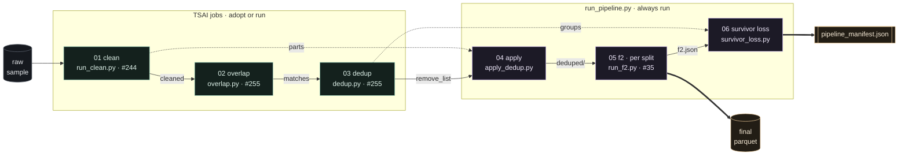
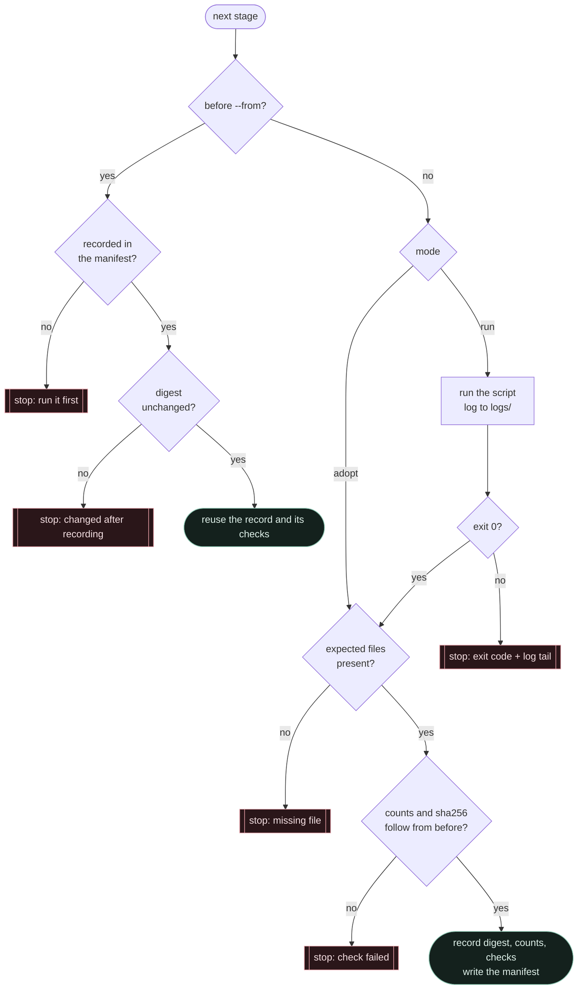

<p align="center">
  
</p>

<p align="center">
  <a href="#quick-start">Quick start</a>&nbsp;&nbsp;·&nbsp;&nbsp;<a href="#how-a-document-travels">Flow</a>&nbsp;&nbsp;·&nbsp;&nbsp;<a href="#the-count-chain">Count chain</a>&nbsp;&nbsp;·&nbsp;&nbsp;<a href="#guards">Guards</a>&nbsp;&nbsp;·&nbsp;&nbsp;<a href="#survivor-loss">Survivor loss</a>&nbsp;&nbsp;·&nbsp;&nbsp;<a href="#outputs-and-the-manifest">Outputs</a>&nbsp;&nbsp;·&nbsp;&nbsp;<a href="#measured-on-real-data">Measured</a>&nbsp;&nbsp;·&nbsp;&nbsp;<a href="#tests">Tests</a>
</p>

<br>

The **Clean → Dedup → F2** pipeline of Data A, as one command. It chains the team's stages in the order TSAI set on 12 Nov, applies dedup's remove list, runs F2 decontamination, reports the duplicate groups F2 emptied, and checks between every pair of stages that each document is accounted for. The output is **filtered Parquet** plus a **manifest** that TSAI can verify.

| | |
|---|---|
| **Order** | clean → overlap → dedup → **apply the remove list** → **F2** → **survivor loss** |
| **In** | the cleaned parts (`train/`, `heldout/`) and the outputs of overlap and dedup |
| **Out** | filtered Parquet in the same layout, same schema, unchanged text · `pipeline_manifest.json` |
| **New here** | `apply_dedup.py` · `survivor_loss.py` · `run_pipeline.py` · `pipeline.json` · 57 tests |
| **Reused, never copied** | `spec_v1/run_clean.py` (#244) · `dedup/overlap.py`, `dedup/dedup.py` (#255) · `spec_v1/run_f2.py` (#35) |
| **Needs** | Python 3.9+ with `pyarrow`; `pytest` for the tests |

> [!NOTE]
> Cleaning, overlap and dedup are **TSAI jobs** (JOB_REQUEST rule 6). The runner **adopts** the folders TSAI returns and checks them before carrying on. Each of those stages can also be **run** locally, for tests and small trials.

<br>

## Quick start

```bash
# tests: synthetic data only, about 15 s
python -m pytest teams/01-data-a/pipeline/tests -q

# the whole chain, from the repository root
python -I teams/01-data-a/pipeline/run_pipeline.py --config teams/01-data-a/pipeline/pipeline.json

# part of it: stop after apply, resume at F2 later
python -I teams/01-data-a/pipeline/run_pipeline.py --config teams/01-data-a/pipeline/pipeline.json --to apply
python -I teams/01-data-a/pipeline/run_pipeline.py --config teams/01-data-a/pipeline/pipeline.json --from f2
```

Each step also runs on its own:

```bash
python -I teams/01-data-a/pipeline/apply_dedup.py   --cleaned <cleaned> --remove-list <remove_list.csv> --out <deduped>
python -I teams/01-data-a/spec_v1/run_f2.py          --inputs <deduped>/train --out <final>/train
python -I teams/01-data-a/pipeline/survivor_loss.py --groups <dedup_groups.csv> --f2 <final> --out <report>
```

Exit code `0`: every check passed. Exit code `1`: a check failed, and the message names it and where. Each script's output streams to `<run>/logs/<stage>.log`.

<br>

## How a document travels

<p align="center"></p>

| | Stage | Script | From | Reads | Writes |
|:-:|---|---|---|---|---|
| 01 | **clean** | `spec_v1/run_tokenizer_sample.py` (`run_clean.py` inside) | #244 | raw parts | `train/**.parquet`, `heldout/**.parquet` |
| 02 | **overlap** | `dedup/overlap.py --config overlap.json` | #255 | cleaned parts | `overlap_summary.json`, `overlap_matches.csv`, `overlap_docs.parquet` |
| 03 | **dedup** | `dedup/dedup.py --config dedup.json` | #255 | overlap outputs | `remove_list.csv`, `dedup_groups.csv`, `dedup_summary.json` |
| 04 | **apply** | `pipeline/apply_dedup.py` | new | cleaned parts + `remove_list.csv` | `deduped/<split>/<part>`, `apply_dedup_summary.json` |
| 05 | **f2** | `spec_v1/run_f2.py`, per split, or per pack in parallel | #35 | `deduped/<split>` | `final/<split>/<part>`, `<part>.f2.json`, `f2_summary.json` |
| 06 | **survivor loss** | `pipeline/survivor_loss.py` | new | `dedup_groups.csv` + F2 reports | `survivor_loss.csv`, `survivor_loss_summary.json` |

<details>
<summary><b>The same flow, with every file</b></summary>
<br>



</details>

<br>

## The count chain

<p align="center"></p>

Each stage must account for every document it was given, and it must have read **exactly** what the stage before produced. Counts catch documents that went missing; sha256 links catch a stage that read the wrong files.

```text
overlap   status = complete
          documents_all            = clean.rows
          documents of every part  = that cleaned part's rows

dedup     status = complete
          checked_sha256 of overlap_matches.csv, overlap_docs.parquet = the adopted overlap's files
          documents_all = overlap.documents_all
          removed       = rows(remove_list.csv)
          heldout_removed = 0

apply     rows = clean.rows,  removed = rows(remove_list.csv)

f2        per split:  rows = apply.kept,  input_sha256 of every part = the sha256 apply wrote
          kept + dropped + errors = rows,  errors = 0,  one set_sha256

survivor  groups = groups in dedup_groups.csv
```

The manifest's `totals` carry the headline: `cleaned → removed_by_dedup → dropped_by_f2 → final`.

<br>

## Guards

<p align="center"></p>

`apply_dedup.py` runs **all** of its checks before it writes anything. Every file is written to `.tmp` and then renamed, so a stopped run never leaves a half-written Parquet in place. The runner stops at the first failed check: the files of the failed run stay in its run folder for inspection, and a rerun refuses Parquet files that don't belong to the current parts.

<details>
<summary><b>Every check, where it runs, what you see</b></summary>
<br>

| Check | Runs in | Message |
|---|---|---|
| Header is exactly `pack_id,split,part,row_in_part,doc_id` | apply | `header is …, expected dedup.py's …` |
| A `(split, part, row)` is listed once; `row_in_part` is a whole number ≥ 0 | apply | `… is listed twice` · `… is not a whole number >= 0` |
| No `heldout` row in the remove list (rule 0) | apply | `a held-out row … this remove list is broken` |
| Every listed part exists and every listed row is inside it | apply | `… not found under --cleaned` · `row 99 is listed, but the part has 5 rows` |
| The doc_id **and** pack_id at that row are the listed ones | apply | `doc_id is 'A', the remove list says 'B'. The list was made from another cleaning run` |
| Every part opens as Parquet with `doc_id` and `pack_id` (footer only) | apply | `… cannot be read as Parquet` · `… no pack_id column` |
| No Parquet under the output that isn't a current part | apply · f2 | `… left by an earlier run` · `no stale F2 output in final/train` |
| Output never inside input, nor input inside output | apply · f2 · config | `… overlap: the output would be read as input` |
| Overlap is complete and read these cleaned parts | runner | `overlap read every cleaned row` · `overlap read these cleaned parts` |
| Dedup is complete, used **this** overlap run, agrees with its list, removed no held-out | runner | `dedup used this overlap run` · `dedup summary matches its remove list` |
| F2 read every row, read what apply wrote, adds up, no errors, one set | runner | `F2 read what apply wrote in train` · `F2 reported no errors on train` |
| Survivor loss saw every dedup group; F2 covered every part holding a survivor | runner · survivor | `survivor loss saw every dedup group` · `… F2 did not cover them` |
| With `--from`, earlier outputs still match their recorded digest | runner | `… changed after the manifest recorded it; rerun from …` |
| The whole config before the first stage | runner | `config: stages.dedup.output is missing` · `f2 script … not found` |

</details>

> [!IMPORTANT]
> **`doc_id` alone is not a key.** In cleaned sample v0 (86 files, 1,432,552 rows), 22,773 doc_ids appear in two parts of the same pack and split. A document is found by **split + part + row** (apply) or **split + part + doc_id** (survivor loss), never by doc_id alone.

<br>

## Survivor loss

<p align="center"></p>

Dedup keeps one copy of each duplicate group, or every held-out copy (rule 0). F2 runs afterwards, and when it drops a survivor, the removed copies are not brought back. TSAI accepted this on 12 Nov, on condition that those groups are **counted and listed**.

| Status | Meaning |
|---|---|
| `lost` | F2 dropped **every** survivor of the group: no copy reaches the final data |
| `partly_hit` | F2 dropped some survivors, not all (only groups with several held-out survivors) |
| `untouched` | F2 dropped none |
| `without_survivor` | dedup kept no copy (no usable licence, rule 1); F2 cannot change that |

A document whose F2 check raised an error is also kept out of the output, so it counts as dropped, with `f2_items` = `error:<type>`. `survivor_loss.csv` has one row per survivor F2 dropped: `status, group_id, group_size, priority_rule, pack_id, split, part, row_in_part, doc_id, f2_items, offset`. Benchmark **item IDs** and offsets only, never text.

<br>

## Configuration

`pipeline.json`: paths relative to the repository root, or absolute; keys starting with `_` are comments.

```jsonc
{
  "run_id": "sample-v0",                 // outputs go to <out>/<run_id>/
  "out": "out/pipeline",                 // git-ignored, like every out/ folder
  "stages": {
    "clean":   { "mode": "adopt", "output": "out/tokenizer_sample_v0_clean" },
    "overlap": { "mode": "adopt", "output": "out/overlap" },
    "dedup":   { "mode": "adopt", "output": "out/dedup" },
    "apply":   { "link": true },             // hard-link untouched parts (no extra disk)
    "f2":      { "script": "teams/01-data-a/spec_v1/run_f2.py", "workers": 4 }
  }
}
```

| Key | Values | Meaning |
|---|---|---|
| `stages.<clean · overlap · dedup>.mode` | `adopt` (default) · `run` | **adopt**: TSAI ran it, and `output` is the folder it returned. **run**: the runner calls `command` |
| `stages.<…>.command` | `["script.py", "--arg", "…"]` | run with this Python from the repository root; `output` is where that script writes |
| `stages.<…>.output` | folder | where the stage's files are, in both modes |
| `stages.f2.script` | path | `run_f2.py` (default `teams/01-data-a/spec_v1/run_f2.py`, from #35) |
| `stages.f2.workers` | whole number ≥ 1 (default 1) | **1**: one `run_f2.py` per split. **N > 1**: up to N processes at once, one per pack folder, with one log per pack |
| `stages.apply.link` | `true` (default) · `false` | hard-link untouched parts instead of copying them; falls back to a copy across file systems |

Scripts run with `python -I`, which ignores user site-packages and `PYTHONPATH`: install `pyarrow` and the rest into the environment itself, not with `pip install --user`. Running overlap locally needs Linux or macOS (`overlap.py` uses `resource`). Adopting TSAI's overlap works anywhere.

<details>
<summary><b>How the runner treats each stage</b></summary>
<br>



</details>

<br>

## Outputs and the manifest

```text
out/pipeline/<run_id>/
├── pipeline_manifest.json             the record of the run
├── logs/                              one log per script: overlap.log, f2_train.log or f2_train_<pack>.log, …
├── deduped/                           04 apply
│   ├── train/<pack>/part-NNNNN.parquet
│   ├── heldout/<pack>/part-NNNNN.parquet      hard links: dedup never removes held-out
│   └── apply_dedup_summary.json
├── final/                             05 F2: the pipeline's output
│   ├── train/<pack>/part-NNNNN.parquet  (+ .f2.json)
│   ├── train/f2_summary.json
│   └── heldout/…
└── report/                            06 survivor loss
    ├── survivor_loss.csv
    └── survivor_loss_summary.json
```

<details>
<summary><b>What <code>pipeline_manifest.json</code> holds</b></summary>
<br>

```jsonc
{
  "tool": "run_pipeline.py", "run_id": "sample-v0",
  "code_sha256": "…", "git_commit": "…", "python": "3.13.x", "pyarrow": "…", "config": { … },
  "stages": [
    { "stage": "clean",   "mode": "adopt", "digest": "…", "files": 86,
      "counts": { "rows": …, "by_split": { … }, "by_part": { "train/en-dclm/part-00000.parquet": …, … } },
      "checks": [], "seconds": … },
    { "stage": "overlap", "counts": { "documents_all": …, "parts": …, "files_sha256": { … } }, "checks": [ … ] },
    { "stage": "dedup",   "counts": { "remove_list_rows": …, "removed": …, "heldout_removed": 0, "groups": … } },
    { "stage": "apply",   "code_sha256": "…", "counts": { "rows": …, "removed": …, "kept": …, "kept_by_split": { … } } },
    { "stage": "f2",      "set_sha256": "2826a3b8…", "counts": { "rows": …, "kept": …, "dropped_by_f2": …, "errors": 0, "by_split": { … } } },
    { "stage": "survivor_loss", "counts": { "lost": …, "partly_hit": …, "untouched": …, … } }
  ],
  "checks": [ { "stage": "dedup", "check": "dedup used this overlap run", "ok": true, "detail": "…" }, … ],
  "totals": { "cleaned": …, "removed_by_dedup": …, "dropped_by_f2": …, "final": … }
}
```

A stage's **digest** is the sha256 over the sorted `relative/path<TAB>hash` of every file in its folder. JSON summaries are hashed without the fields that change between identical runs (timings, absolute paths, skip flags), so two runs on the same inputs give the same digests (a test checks this). Each stage keeps its own checks, so a `--from` run still carries the earlier stages' checks.

</details>

### Shards

`shards/shard_writer.py` makes one shard from one part of `final/`. Before it writes anything, `shards/provenance.py` checks the part's chain back to the raw sample part (`shards/shard_format_v1.md`, "Where a shard's input comes from").

```bash
python -I teams/01-data-a/shards/shard_writer.py --input <run>/final/train/<pack>/<part>.parquet \
    --manifest <run>/pipeline_manifest.json --tokenizer <tokenizer.json> \
    --language <language> --script <script> --lane <lane> --out <dir>
```

| Argument | Meaning |
|---|---|
| `--input` | a part under `<run>/final/<split>/<pack>/`; only `train` parts are sharded for now |
| `--manifest` | the run's `pipeline_manifest.json` |
| `--tokenizer` | G3's frozen C3 `tokenizer.json` (`--any-tokenizer` accepts another one, for tests only) |
| `--language`, `--script`, `--lane` | recorded in the shard's manifest |
| `--domain` | optional; default: the pack's family in `clean.py` |
| `--index`, `--tokens` | shard number (default 0) and token limit (default 2^26) |
| `--out` | output folder |

`shards/run_shards.py` runs the writer on every part of a run's `final/` folder:

```bash
python -I teams/01-data-a/shards/run_shards.py --input <run>/final --manifest <run>/pipeline_manifest.json \
    --tokenizer <tokenizer.json> --out <dir> [--pack <pack> ...] [--tokens <n>]
```

| Argument | Meaning |
|---|---|
| `--input` | the run's `final/` folder: `<split>/<pack>/<part>.parquet`. Every part found goes to the writer, which refuses what it does not shard |
| `--manifest`, `--tokenizer`, `--out`, `--tokens` | as for the writer |
| `--pack` | only this pack (repeatable) |

Language, script, domain and lane come from the pack's row in `shards/pack_table.json`; a pack that is not in the table, or has a null field, is skipped. The shard number is the part's number (`part-00001.parquet` becomes `<pack>-train-000001`). Nothing is written if one of the shards is already in `--out`. A part the writer stops on is recorded and the run goes on; the exit code is 1 unless every part was written. `<out>/shards_summary.json` lists each part with its status, shard id, docs, tokens, rows read of the rows in the part, and `truncated` (the writer fills one shard per part up to `--tokens` and drops the rest).

<br>

## Data handling

- **IDs, counts, offsets and hashes only.** No summary, report, log or manifest holds document text or benchmark text, and the tests check this.
- **Outputs live in `out/`**, which git ignores. Parquet, archives and files over 5 MB never go into the repository.
- **Untouched parts stay untouched.** A part with nothing to remove is hard-linked (or byte-copied), so its sha256 proves it, and it costs no extra disk. Nothing in the pipeline edits a file in place: every write goes to `.tmp` and is renamed, so a link never changes its source. A filtered part keeps its row groups and compression codec.
- **Benchmarks:** F2 uses G9's pinned fingerprint set v2 (`set_sha256 2826a3b8…d22a`), unchanged. The pipeline sees benchmark item IDs, never benchmark text.

<br>

## Measured on real data

Smoke run on 13 Nov: a Windows laptop, one process, two packs of cleaned sample v0 (**ind-ta-sangraha-s** and **sci-finepdfs**, both splits, 10,446 documents), a hand-made 3-row remove list, and the **real** `run_f2.py` (#35) with G9's **full** set v2.

| Stage | Result | Time |
|---|---|---:|
| apply | 10,446 → 3 removed → 10,443 · held-out parts byte-identical | 1.7 s |
| f2 | 10,443 → **14 benchmark copies dropped** (all in sci-finepdfs) → 10,429 · 0 errors | **467 s** |
| survivor loss | every group accounted for; a real F2-dropped survivor, made a survivor on purpose, is reported as `lost` | 0.1 s |
| runner | **21 of 21 checks passed**, including every sha256 link · a changed adopted folder is refused on `--from` | |
| f2, 2 workers | 4 units (one per pack and split) · **identical final Parquet and totals** · 23 of 23 checks · held-out parts hard-linked | **400 s** |

> [!WARNING]
> **F2 dominates the run time.** It checked about **15 docs/s on sci-finepdfs** (long PDF text) and **53 docs/s on Tamil**, plus about 10 s per split to load the set. At those rates the **1,432,552 documents** of sample v0 take roughly **8 to 26 hours in one process**. For the week-3 run, set `stages.f2.workers` (one `run_f2.py` per pack, about 1.1 GB of memory each). The wall time is then bounded by the **largest pack** (in the smoke run, sci-finepdfs alone took about 400 s), so expect roughly `total / workers`, but never less than the slowest pack. Size it as `workers ≈ min(cores − 1, free RAM in GB ÷ 1.5, number of packs)`.

<br>

## Tests

```bash
python -m pytest teams/01-data-a/pipeline/tests -q      # 57 passed
```

| File | Tests | Covers |
|---|:-:|---|
| `test_apply_dedup.py` | 25 | exact removal · byte copies · hard links (and `--copy`) · the same doc_id in two parts · Windows `\` paths · 8 bad lists, each with the bad row in the last part processed and nothing written · an unreadable or column-less part · row-group boundaries, with zstd kept · stale outputs · a corrupted output redone on rerun · train-only · resume · no text in the summary · CLI |
| `test_survivor_loss.py` | 9 | lost · partly hit · untouched · without survivor · split + part + doc_id matching · F2 errors count as dropped · no drops · an uncovered part · mixed fingerprint sets · CLI |
| `test_run_pipeline.py` | 23 | the full chain (13 → 11 → 9) · parallel F2 gives the same result as one process · a crashed pack is named and a rerun recovers · bad `workers` values · identical runs give identical digests · `--from` keeps earlier checks · a changed adopted folder · dedup from another overlap run · overlap of other parts · count mismatch · held-out removed · F2 errors · F2 that read other files · stale F2 output · train-only · `run` mode success and failure · a bad config stopped before anything runs · CLI |

The data is made up inside the tests (`conftest.py`), in dedup's real formats (`G000001` group ids, rule numbers 0–4). The runner's tests use `tests/fake_run_f2.py`, a stand-in with `run_f2.py`'s command line, its output files and its exit codes. The real F2 needs G9's full set (about 1.1 GB) and is tested in its own PR, and on real data above.

<br>

## Design decisions

| Decision | Why |
|---|---|
| **Call the team's scripts, never copy them** | Their owners still change them in open PRs. A copy would drift, and its sha256 would no longer match what TSAI checks. |
| **Adopt or run** for clean, overlap and dedup | TSAI runs the data jobs, so the runner has to start from what TSAI returns. |
| **Link stages by sha256, not only by counts** | Two runs can have the same counts. Only hashes prove that dedup used this overlap and that F2 read what apply wrote. |
| **F2 after dedup, as its own stage** | TSAI's order (12 Nov). Runs are per split (or per pack), so `train/` and `heldout/` never collide in F2's output. |
| **Parallel F2 by pack, not by part** | F2 is the slow stage, and each process loads the 1.1 GB set once. Packs are big enough to keep that load small next to the work, and small enough to spread across cores. |
| **Hard-link untouched parts** | A third copy of the sample would triple the disk; a link costs nothing and keeps the same sha256. |
| **Find rows by position, then verify the doc_id** | doc_ids repeat across parts. A mismatch means the list belongs to another cleaning run. |
| **A held-out row in the list stops the run** | Rule 0 says dedup never removes held-out documents. If one is listed, something upstream is broken. |
| **Byte-copy untouched parts** | The sha256 proves the part is untouched, and copying is faster than rewriting. |
| **"Lost" vs "partly hit"** | Held-out groups can have several survivors. Losing one is not losing the group. |
| **Fail closed** | A half-filtered dataset is worse than no dataset. |

<br>

## Troubleshooting

| Message | Meaning | Fix |
|---|---|---|
| `doc_id is 'A', the remove list says 'B'` | the remove list was made from different cleaned parts | point `clean.output` at the parts dedup used, or rerun overlap and dedup |
| `dedup used this overlap run` failed | the adopted dedup output came from another overlap run | adopt the matching pair of folders, or rerun dedup |
| `a held-out row … rule 0` | dedup's output is broken | report it to the dedup owners; don't edit the list by hand |
| `… left by an earlier run` · `no stale F2 output` | the run folder holds parts that aren't in the current input | use a new `run_id`, or delete that run folder |
| `F2 reported no errors on train` failed | some documents raised during the F2 check | see `logs/f2_train.log` and the `errors` in the `.f2.json` files |
| `f2 script … not found` | #35 is not on this branch | set `stages.f2.script` to where `run_f2.py` is |
| `… changed after the manifest recorded it` | an adopted folder changed since the last run | rerun from that stage (`--from <stage>`) |
| `--from f2: stage clean has no record` | `--from` needs the earlier stages recorded | run once without `--from`, or with `--to apply` |

<br>

<p align="center"><sub>Data A · G1 · ERA V5 Capstone Lab&nbsp;&nbsp;·&nbsp;&nbsp;design: <code>dedup/dedup_design_v1.md</code>&nbsp;&nbsp;·&nbsp;&nbsp;F2: <code>teams/09-evaluation/decontam</code>&nbsp;&nbsp;·&nbsp;&nbsp;fonts in the figures: Space Grotesk and JetBrains Mono (SIL OFL 1.1)</sub></p>
