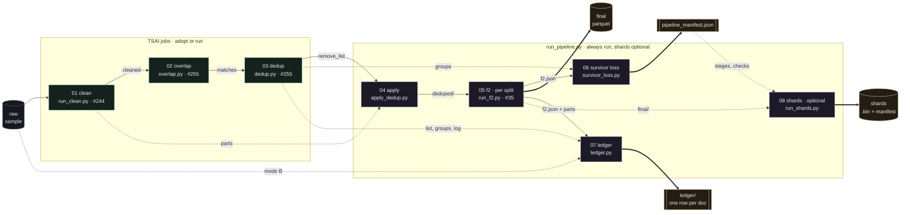
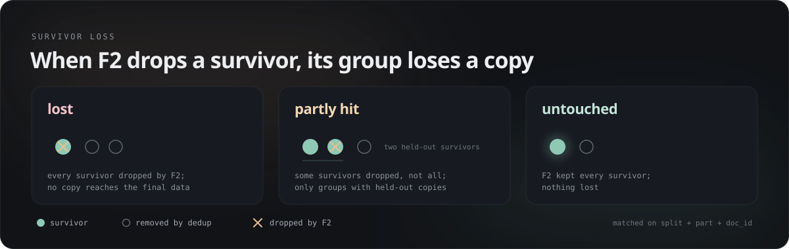
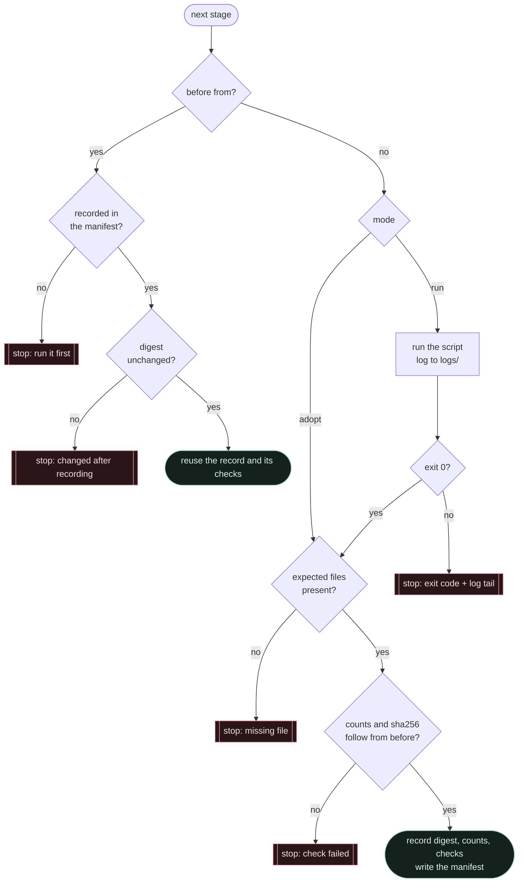

<p align="center">
  
</p>

<p align="center">
  <a href="#quick-start">Quick start</a>&nbsp;&nbsp;·&nbsp;&nbsp;<a href="#how-a-document-travels">Flow</a>&nbsp;&nbsp;·&nbsp;&nbsp;<a href="#the-count-chain">Count chain</a>&nbsp;&nbsp;·&nbsp;&nbsp;<a href="#guards">Guards</a>&nbsp;&nbsp;·&nbsp;&nbsp;<a href="#survivor-loss">Survivor loss</a>&nbsp;&nbsp;·&nbsp;&nbsp;<a href="#the-ledger">Ledger</a>&nbsp;&nbsp;·&nbsp;&nbsp;<a href="#outputs-and-the-manifest">Outputs</a>&nbsp;&nbsp;·&nbsp;&nbsp;<a href="#measured-on-real-data">Measured</a>&nbsp;&nbsp;·&nbsp;&nbsp;<a href="#tests">Tests</a>
</p>

<br>

The **Clean → Dedup → F2** pipeline of Data A, as one command. It chains the team's stages in the order TSAI set on 12 Nov, applies dedup's remove list, runs F2 decontamination, reports the duplicate groups F2 emptied, writes a **ledger** of every document's decision at every stage, and checks between every pair of stages that each document is accounted for. The output is **filtered Parquet** plus a **manifest** that TSAI can verify.

| | |
|---|---|
| **Order** | clean → overlap → dedup → **apply the remove list** → **F2** → **survivor loss** → **ledger** → **shards** (optional) |
| **In** | the cleaned parts (`train/`, `heldout/`) and the outputs of overlap and dedup |
| **Out** | filtered Parquet in the same layout, same schema, unchanged text · `pipeline_manifest.json` · the ledger, one row per document · shards (optional) |
| **New here** | `apply_dedup.py` · `survivor_loss.py` · `ledger.py` · `f2_pool.py` · `run_pipeline.py` · `pipeline.json` · `stage_args.py` · `local_trial/` · 151 tests |
| **Reused, never copied** | `spec_v1/run_clean.py` (#244) · `dedup/overlap.py`, `dedup/dedup.py` (#255) · `spec_v1/run_f2.py` (#35) |
| **Needs** | Python 3.9+ with `pyarrow`; `pytest` for the tests |

> [!NOTE]
> Cleaning, overlap and dedup are **TSAI jobs** (JOB_REQUEST rule 6). The runner **adopts** the folders TSAI returns and checks them before carrying on. Each of those stages can also be **run** locally, for tests and small trials.

<br>

## Quick start

```bash
# tests: synthetic data only, about 45 s
python -m pytest teams/01-data-a/pipeline/tests -q

# what a run would do (every stage's folder and command; runs and writes nothing)
python -I teams/01-data-a/pipeline/run_pipeline.py --config teams/01-data-a/pipeline/pipeline.json --plan

# the whole chain, from the repository root
python -I teams/01-data-a/pipeline/run_pipeline.py --config teams/01-data-a/pipeline/pipeline.json

# part of it: set "to": "apply" in the config file and run; later set "from": "f2" (and drop "to") and run again
```

The command line takes only `--config` and `--plan`. Everything that defines a run is a key in the config file (see Configuration), so a run is reproduced from that file alone.

**Try it on six small files first:** [local_trial/](local_trial/README.md) has example configs for a full run, stopping early, resuming in steps, adopting a folder and the expected errors, and the commands to run them and keep the local log a job request asks for.

Each step also runs on its own:

```bash
python -I teams/01-data-a/pipeline/apply_dedup.py   --cleaned <cleaned> --remove-list <remove_list.csv> --out <deduped>
python -I teams/01-data-a/spec_v1/run_f2.py          --inputs <deduped>/train --out <final>/train
python -I teams/01-data-a/pipeline/survivor_loss.py --groups <dedup_groups.csv> --f2 <final> --out <report>
python -I teams/01-data-a/pipeline/ledger.py        --cleaned <cleaned> --remove-list <remove_list.csv> --groups <dedup_groups.csv> \
                                                    --log <dedup_log.jsonl> --f2 <final> --out <ledger> [--raw <raw>]
```

Exit code `0`: every check passed. Exit code `1`: a check failed, and the message names it and where. Each script's output streams to `<run>/logs/<stage>.log`.

<br>

## How a document travels

<p align="center"></p>

| | Stage | Script | From | Reads | Writes |
|:-:|---|---|---|---|---|
| 01 | **clean** | `spec_v1/run_tokenizer_sample.py` (`run_clean.py` inside) | #244 | raw parts | `train/**.parquet`, `heldout/**.parquet` |
| 02 | **overlap** | `dedup/overlap.py --config <run>/cfg/overlap.json` | #255 | cleaned parts | `overlap_summary.json`, `overlap_matches.csv`, `overlap_docs.parquet` |
| 03 | **dedup** | `dedup/dedup.py --config <run>/cfg/dedup.json` | #255 | overlap outputs | `remove_list.csv`, `dedup_groups.csv`, `dedup_summary.json` |
| 04 | **apply** | `pipeline/apply_dedup.py` | new | cleaned parts + `remove_list.csv` | `deduped/<split>/<part>`, `apply_dedup_summary.json` |
| 05 | **f2** | `spec_v1/run_f2.py`, per split, or per pack in parallel | #35 | `deduped/<split>` | `final/<split>/<part>`, `<part>.f2.json`, `f2_summary.json` |
| 06 | **survivor loss** | `pipeline/survivor_loss.py` | new | `dedup_groups.csv` + F2 reports | `survivor_loss.csv`, `survivor_loss_summary.json` |
| 07 | **ledger** | `pipeline/ledger.py` | new | cleaned parts (+ raw parts), dedup's list, groups and log, F2's reports and final parts | `ledger/<split>/<pack>.parquet`, `ledger_summary.json`, `ledger_sample.csv` |
| 08 | **shards** (optional) | `shards/run_shards.py` → `shard_writer.py`, after `cleaning_pipeline.json` is written | new | `final/<split>/<part>` + the manifest | `shards/<pack>-<split>-NNNNNN.{bin,idx.npy,docs.parquet,json,quality_report.json}`, `shards_summary.json` |

Without `stages.shards` the run stops after the ledger. In **run** mode each stage gets its folder and its script's paths from the run config (`settings`; see Configuration), and `--plan` prints them.

<details>
<summary><b>The same flow, with every file</b></summary>
<br>



</details>

<br>

## The count chain

<p align="center"></p>

Each stage must account for every document it was given, and it must have read **exactly** what the stage before produced. Counts catch documents that went missing; sha256 links catch a stage that read the wrong files.

```text
overlap   status = complete
          documents_all            = clean.rows
          documents of every part  = that cleaned part's rows

dedup     status = complete
          checked_sha256 of overlap_matches.csv, overlap_docs.parquet = the adopted overlap's files
          documents_all = overlap.documents_all
          removed       = rows(remove_list.csv)
          heldout_removed = 0

apply     rows = clean.rows,  removed = rows(remove_list.csv)

f2        per split:  rows = apply.kept,  input_sha256 of every part = the sha256 apply wrote
          kept + dropped + errors = rows,  errors = 0,  one set_sha256

survivor  groups = groups in dedup_groups.csv

ledger    rows with a cleaned row = clean.rows
          removed_by_dedup = apply.removed,  dropped_by_f2 = f2.dropped,  f2_error = f2.errors,  kept = f2.kept
          set_sha256 = F2's,  and every final part holds the ledger's kept docs, in order
```

The manifest's `totals` carry the headline: `cleaned → removed_by_dedup → dropped_by_f2 → final`, with `raw` and `dropped_by_clean` in front when the ledger ran in mode B.

<br>

## Guards

<p align="center"></p>

`apply_dedup.py` runs **all** of its checks before it writes anything. Every file is written to `.tmp` and then renamed, so a stopped run never leaves a half-written Parquet in place. The runner stops at the first failed check: the files of the failed run stay in its run folder for inspection, and a rerun refuses Parquet files that don't belong to the current parts.

<details>
<summary><b>Every check, where it runs, what you see</b></summary>
<br>

| Check | Runs in | Message |
|---|---|---|
| Header is exactly `pack_id,split,part,row_in_part,doc_id` | apply | `header is …, expected dedup.py's …` |
| A `(split, part, row)` is listed once; `row_in_part` is a whole number ≥ 0 | apply | `… is listed twice` · `… is not a whole number >= 0` |
| No `heldout` row in the remove list (rule 0) | apply | `a held-out row … this remove list is broken` |
| Every listed part exists and every listed row is inside it | apply | `… not found under --cleaned` · `row 99 is listed, but the part has 5 rows` |
| The doc_id **and** pack_id at that row are the listed ones | apply | `doc_id is 'A', the remove list says 'B'. The list was made from another cleaning run` |
| Every part opens as Parquet with `doc_id` and `pack_id` (footer only) | apply | `… cannot be read as Parquet` · `… no pack_id column` |
| No Parquet under the output that isn't a current part | apply · f2 | `… left by an earlier run` · `no stale F2 output in final/train` |
| Output never inside input, nor input inside output | apply · f2 · config | `… overlap: the output would be read as input` |
| Overlap is complete and read these cleaned parts | runner | `overlap read every cleaned row` · `overlap read these cleaned parts` |
| Dedup is complete, used **this** overlap run, agrees with its list, removed no held-out | runner | `dedup used this overlap run` · `dedup summary matches its remove list` |
| F2 read every row, read what apply wrote, adds up, no errors, one set | runner | `F2 read what apply wrote in train` · `F2 reported no errors on train` |
| Survivor loss saw every dedup group; F2 covered every part holding a survivor | runner · survivor | `survivor loss saw every dedup group` · `… F2 did not cover them` |
| Every row the remove list, groups or log names is a row of its cleaned part, with that doc_id | ledger | `… name another doc_id than the cleaned part holds at that row` |
| No row named twice; the groups' removed rows and the log's rows are exactly the remove list's rows | ledger | `… names 1 row(s) of this part more than once` · `… in one of remove_list.csv and dedup_log.jsonl but not the other` |
| doc_id is unique within each part; mode B: the raw file has the reported sha256, and every cleaned doc is in it | ledger | `a doc_id appears twice in the part` · `no raw part has the sha256 the cleaning report names` · `… cleaned doc(s) are not in the raw part` |
| Every F2 report covers its part; each final part holds exactly the ledger's kept docs, in order | ledger | `no F2 report` · `the final part … does not hold the ledger's … kept documents in order` |
| Mode B with cleaning reports: drops and input rows per part agree | ledger | `… the cleaning report …` |
| Ledger totals = apply's and F2's counts | runner | `ledger kept = F2's kept` · `ledger removed_by_dedup = apply's removed` |
| With `from`, earlier outputs still match their recorded digest | runner | `… changed after the manifest recorded it; rerun from …` |
| The whole config before the first stage | runner | `config: stages.dedup.output is missing` · `f2 script … not found` |
| A run stage's settings file exists and matches its pin; its output is below `out/`, not a folder of the run, not another stage's | runner (config) | `config: overlap: … pins …` · `… named subfolder …` · `… is a folder of the run itself` · `stages.clean.output and stages.overlap.output overlap` |
| Shards: no part failed or was skipped, `run_shards.py` exited 0, at least one shard written, the summary is this run's | runner | `shards: no part failed or was skipped` · `shards: the summary is this run's, made with this run's cleaning_pipeline.json` |

</details>

> [!IMPORTANT]
> **`doc_id` alone is not a key.** In cleaned sample v0 (86 files, 1,432,552 rows), 22,773 doc_ids appear in two parts of the same pack and split. A document is found by **split + part + row** (apply) or **split + part + doc_id** (survivor loss), never by doc_id alone.

<br>

## Survivor loss

<p align="center"></p>

Dedup keeps one copy of each duplicate group, or every held-out copy (rule 0). F2 runs afterwards, and when it drops a survivor, the removed copies are not brought back. TSAI accepted this on 12 Nov, on condition that those groups are **counted and listed**.

| Status | Meaning |
|---|---|
| `lost` | F2 dropped **every** survivor of the group: no copy reaches the final data |
| `partly_hit` | F2 dropped some survivors, not all (only groups with several held-out survivors) |
| `untouched` | F2 dropped none |
| `without_survivor` | dedup kept no copy (no usable licence, rule 1); F2 cannot change that |

A document whose F2 check raised an error is also kept out of the output, so it counts as dropped, with `f2_items` = `error:<type>`. `survivor_loss.csv` has one row per survivor F2 dropped: `status, group_id, group_size, priority_rule, pack_id, split, part, row_in_part, doc_id, f2_items, offset`. Benchmark **item IDs** and offsets only, never text.

<br>

## The ledger

<p align="center"></p>

The team asked for **every document's decision at every stage, including the documents that were dropped**. The ledger answers "what happened to this document, and why?" without opening any text: one row per document, with the cleaner's action, dedup's role and match, F2's action and benchmark items, and exactly one `final` status. It is built from what each stage wrote, so it decides nothing; it only lines the decisions up and checks that they agree.

<table>
<tr><th>Stage</th><th>Columns</th><th>Values</th></tr>
<tr><td>identity</td><td><code>pack_id</code> · <code>split</code> · <code>part</code> · <code>raw_row</code> · <code>row_in_part</code> · <code>doc_id</code></td><td><code>row_in_part</code> is the row in the cleaned part, as dedup numbers it (empty when the cleaner dropped the doc). <code>raw_row</code> is the row in the raw part (mode B only)</td></tr>
<tr><td>clean</td><td><code>clean_action</code> · <code>clean_rules</code></td><td><code>keep</code> · <code>fix</code> · <code>drop</code> · <code>unknown</code>; rule ids once mode A exists</td></tr>
<tr><td>dedup</td><td><code>dedup_role</code> · <code>dedup_group</code> · <code>dedup_priority_rule</code></td><td><code>none</code> · <code>survivor</code> · <code>removed</code>; <code>G000123</code>; rule <code>0</code>–<code>4</code> of source_priority_v1.md</td></tr>
<tr><td></td><td><code>dedup_match_rule</code> · <code>dedup_similarity</code> · <code>dedup_kept_doc</code> · <code>dedup_stage</code></td><td>from <code>dedup_log.jsonl</code>, for removed docs: <code>H1</code>/<code>H2</code>, the Jaccard score, the survivor's doc_id, <code>within_pack</code> or <code>cross_pack</code></td></tr>
<tr><td></td><td><code>dedup_list</code></td><td>which remove list removed it: <code>dedup</code> (dedup.py's list); later H3's</td></tr>
<tr><td>F2</td><td><code>f2_action</code> · <code>f2_items</code> · <code>f2_offset</code></td><td><code>kept</code> · <code>dropped</code> · <code>error</code> (empty when F2 never saw the doc); benchmark item ids; the character offset</td></tr>
<tr><td>final</td><td><code>final</code> · <code>final_part</code> · <code>final_row</code></td><td><code>kept</code> · <code>dropped_by_clean</code> · <code>removed_by_dedup</code> · <code>dropped_by_f2</code> · <code>f2_error</code>; where a kept doc is in <code>final/&lt;split&gt;/</code></td></tr>
</table>

**The cleaner's decision** depends on what is available, and the ledger records which mode it ran in:

| Mode | When | How |
|:-:|---|---|
| **A** | the cleaning job writes a per-document decisions file (not yet: a small addition to `run_tokenizer_sample.py`, to agree with its owners) | rule ids per document |
| **B** | `stages.ledger.raw` points at the raw parts | the raw file of each part is the one whose sha256 the cleaning job's report names (any file name, as the cleaner finds it), or the file of the same name when there is no report. It is joined to its cleaned part on doc_id (the cleaner refuses duplicate doc_ids in a part). Missing from the cleaned part: `drop`. Different text: `fix`. Same text: `keep`. The text is compared inside pyarrow and never written anywhere |
| **C** | neither | the ledger starts at the cleaned documents and `clean_action` is `unknown` |

When the cleaning job's per-part reports are in the cleaned folder (`reports/<split>/<part>.json`), the summary records their keep / fix / drop counts, and mode B stops if its drops or raw rows per part differ from them. In mode B the summary lists every raw file used, with its sha256, so two runs on different raw data never get the same digest.

**How rows are matched.** Dedup's list, groups and log are joined on **split + part + row** and must name the doc_id the cleaned part holds at that row; none may name a row twice, and the groups' removed rows and the log's rows must both be exactly the remove list's rows. F2's reports are joined on **split + part + doc_id**, and every doc_id they name must be one apply kept in that part. A kept document's `final_row` is its rank among the kept rows of its part, and the ledger reads each final part to check that it holds exactly those doc_ids in that order. The ledger is built **part by part with pyarrow joins and compute functions**: no Python loop over documents, and no numpy needed.

```text
ledger/
├── train/<pack>.parquet      one row per document (zstd), one file per pack and split
├── heldout/<pack>.parquet
├── ledger_summary.json       clean mode · inputs and their sha256 · totals and per pack × split counts by final status
└── ledger_sample.csv         to read by eye: per pack and split, up to 5 rows of each final status
```

<details>
<summary><b>Reading the ledger</b></summary>
<br>

```python
from pathlib import Path
import pyarrow.parquet as pq, pyarrow.compute as pc

t = pq.read_table(sorted(Path("out/pipeline/sample-v0/ledger").rglob("*.parquet")))
t.group_by(["pack_id", "split", "final"]).aggregate([("doc_id", "count")])     # the outcome per pack
t.filter(pc.equal(t["doc_id"], "<doc_id>"))                                  # every copy of one doc_id, with its part
t.filter(pc.equal(t["final"], "dropped_by_f2")).select(["pack_id", "doc_id", "f2_items", "f2_offset"])
```

`ledger_summary.json` holds the same counts without reading any Parquet. From the 2-pack smoke run:

```jsonc
"by_pack": {
  "sci-finepdfs": {
    "train":   { "rows": 6011, "rows_cleaned": 6011, "kept": 5995, "dropped_by_clean": 0, "removed_by_dedup": 2, "dropped_by_f2": 14, "f2_error": 0 },
    "heldout": { "rows": 63,   "rows_cleaned": 63,   "kept": 63,   "dropped_by_clean": 0, "removed_by_dedup": 0, "dropped_by_f2": 0,  "f2_error": 0 }
  }, …
}
```

</details>

<br>

## Configuration

`pipeline.json`: paths relative to the repository root, or absolute; keys starting with `_` are comments.

```jsonc
{
  "run_id": "sample-v0",                 // outputs go to <out>/<run_id>/; --run-id replaces it per job
  "out": "out/pipeline",                 // git-ignored, like every out/ folder
  "stages": {
    "clean":   { "mode": "run", "settings": "teams/01-data-a/spec_v1/clean.json", "input": "inputs/tokenizer_sample_v0",
                 "manifest_sha256": "7fd647c8…", "expected_parts": { "train": 48, "heldout": 38 } },
    "overlap": { "mode": "run", "settings": "teams/01-data-a/dedup/overlap.json" },
    "dedup":   { "mode": "run", "settings": "teams/01-data-a/dedup/dedup.json" },
    "apply":   { "link": true },             // hard-link untouched parts (no extra disk)
    "f2":      { "script": "teams/01-data-a/spec_v1/run_f2.py", "workers": 4 },
    "ledger":  { "raw": "out/tokenizer_sample_v0_raw" },  // optional: mode B
    "shards":  { "tokenizer": "<c3>/tokenizer.json" }   // optional: leave it out and the run stops after the ledger
  }
}
```

| Key | Values | Meaning |
|---|---|---|
| `stages.<clean · overlap · dedup>.mode` | `adopt` (default) · `run` | **adopt**: TSAI ran it, and `output` is the folder it returned. **run**: the runner runs the stage's script |
| `stages.<…>.settings` | file | **run**: the stage's settings (no paths). The runner works out the rest: each of clean, overlap and dedup gets a copy with its path keys filled in, in `<run>/cfg/<stage>.json`, and is run with `--config` on that copy |
| `stages.clean.input` | folder | **required** for a run: the raw sample, written into the clean config as `input_root` (the settings file holds no paths) |
| `stages.clean.manifest_sha256` · `.expected_parts` · `.sample` | sha256 · `{"train": 48, "heldout": 38}` · label | **required** (the label is optional): the input set's description, written into the clean config. A new input set means new values; the clean settings file holds none of them |
| `stages.clean.manifest` | file | optional: the sample manifest. Default: `sample_manifest.json` in the `input` folder, where TSAI ships it. Its sha256 must equal `manifest_sha256`, checked before the clean job starts |
| `stages.clean.only` | list of sample parts | run the clean job on these parts only (e.g. `["train/code-go/part-00000.parquet"]`), for trials; overlap then expects no particular packs |
| `stages.<…>.settings_sha256` | sha256 | optional pin of the settings file, checked before anything runs; the manifest records the file's sha256 either way |
| `stages.<…>.script` | path | replaces the stage's default script (`run_tokenizer_sample.py`, `dedup/overlap.py`, `dedup/dedup.py`) |
| `stages.<…>.output` | folder | **adopt**: required, the folder returned. **run**: optional, default `<run>/<stage>`; must be below `out/` and not a folder name of the run (`deduped`, `final`, `report`, `shards`, `cfg`, `logs`) |
| `stages.<…>.command` | `["script.py", "--arg", "…"]` | escape hatch for **run**: run this Python from the repository root as it is (then `output` is required, and no settings or generated config are involved) |
| `stages.f2.script` | path | `run_f2.py` (default `teams/01-data-a/spec_v1/run_f2.py`, from #35) |
| `stages.f2.workers` | whole number ≥ 1 (default 1) | **1**: one `run_f2.py` per split. **N > 1**: up to N processes at once, one per pack folder, with one log per pack |
| `stages.shards.tokenizer` | file | G3's C3 `tokenizer.json`. Setting `stages.shards` adds the shard stage after survivor loss; without it the run stops there |
| `stages.shards.out` | folder (default `<run>/shards`) | where the shards, `cleaning_pipeline.json` and `shards_summary.json` go |
| `stages.shards.tokens` · `.packs` · `.pack_table` | optional | passed to `run_shards.py`: token limit per shard, only these packs, a pack table other than `shards/pack_table.json` |
| `stages.shards.script` · `.any_tokenizer` | optional | `run_shards.py` (default `teams/01-data-a/shards/run_shards.py`); `any_tokenizer: true` accepts another tokenizer (tests only) |
| `stages.apply.link` | `true` (default) · `false` | hard-link untouched parts instead of copying them; falls back to a copy across file systems |
| `stages.ledger.raw` | folder (optional) | the raw parts the cleaner read, as `<raw>/<split>/<pack>/<file>` or `<raw>/<pack>/<split>/<file>` (found by the sha256 in the cleaning report, else by name): the ledger runs in **mode B** (keep / fix / drop per document). Without it, **mode C** |

**One file per run.** Everything that defines a run is a key in the config file, and `--config <file>` is all a TSAI job's `Command:` needs. The committed `pipeline.json` is the generic template (no dates, no returned folders); for a job, copy it to `jobs/<date>-<name>/run.json` and edit that copy:

| Key | Meaning |
|---|---|
| `run_id` | names the run; its folders are `<out>/<run_id>/` (the clean job refuses an existing folder, so each run needs its own) |
| `stages.<clean · overlap · dedup>` with `"mode": "adopt"` and `"output": <folder>` | use a folder TSAI returned (or an earlier run's) instead of running that stage. The other stages always run |
| `to` | stop after this stage; only the stages up to it are checked, so a clean-only job needs no overlap or dedup entry |
| `from` | resume at this stage: earlier stages must be recorded in the manifest with unchanged digests |
| `stages.clean.only` | run the clean job on these sample parts only; for trials |

The only command-line option besides `--config` is `--plan`: print every stage's folder and command and run nothing.

```jsonc
// jobs/<date>-dedup/run.json: TSAI returned the cleaned folder; test the dedup change on it, stop after dedup
{ "run_id": "dedup-trial-1",
  "to": "dedup",
  "stages": {
    "clean":   { "mode": "adopt", "output": "out/<returned clean folder>" },
    "overlap": { "settings": "teams/01-data-a/dedup/overlap.json" },
    "dedup":   { "settings": "teams/01-data-a/dedup/dedup.json" } } }
```
```bash
python -I teams/01-data-a/pipeline/run_pipeline.py --config teams/01-data-a/jobs/<date>-dedup/run.json
```

Scripts run with `python -I`, which ignores user site-packages and `PYTHONPATH`: install `pyarrow` and the rest into the environment itself, not with `pip install --user`. Running overlap locally needs Linux or macOS (`overlap.py` uses `resource`). Adopting TSAI's overlap works anywhere.

<details>
<summary><b>How the runner treats each stage</b></summary>
<br>



</details>

<br>

## Outputs and the manifest

```text
out/pipeline/<run_id>/
├── pipeline_manifest.json             the record of the run
├── logs/                              one log per script: overlap.log, f2_train.log or f2_train_<pack>.log, shards.log, …
├── deduped/                           04 apply
│   ├── train/<pack>/part-NNNNN.parquet
│   ├── heldout/<pack>/part-NNNNN.parquet      hard links: dedup never removes held-out
│   └── apply_dedup_summary.json
├── final/                             05 F2: the pipeline's output
│   ├── train/<pack>/part-NNNNN.parquet  (+ .f2.json)
│   ├── train/f2_summary.json
│   └── heldout/…
├── report/                            06 survivor loss
│   ├── survivor_loss.csv
│   └── survivor_loss_summary.json
├── ledger/                            07 ledger
│   ├── train/<pack>.parquet, heldout/<pack>.parquet
│   ├── ledger_summary.json
│   └── ledger_sample.csv
├── cleaning_pipeline.json             08 shards, first: clean.py sha256, F2 set, dedup remove list (what every shard of the run says)
└── shards/                            08 shards: <pack>-<split>-NNNNNN.{bin,idx.npy,docs.parquet,json,quality_report.json,dump.md},
    ├── cleaning_pipeline.json         a copy of the run's file, and shards_summary.json
    └── shards_summary.json
```

<details>
<summary><b>What <code>pipeline_manifest.json</code> holds</b></summary>
<br>

```jsonc
{
  "tool": "run_pipeline.py", "run_id": "sample-v0",
  "code_sha256": "…", "git_commit": "…", "python": "3.13.x", "pyarrow": "…", "config": { … },
  "stages": [
    { "stage": "clean",   "mode": "adopt", "digest": "…", "files": 86,
      "counts": { "rows": …, "by_split": { … }, "by_part": { "train/en-dclm/part-00000.parquet": …, … } },
      "checks": [], "seconds": … },
    { "stage": "overlap", "counts": { "documents_all": …, "parts": …, "files_sha256": { … } }, "checks": [ … ] },
    { "stage": "dedup",   "counts": { "remove_list_rows": …, "removed": …, "heldout_removed": 0, "groups": … } },
    { "stage": "apply",   "code_sha256": "…", "counts": { "rows": …, "removed": …, "kept": …, "kept_by_split": { … } } },
    { "stage": "f2",      "set_sha256": "2826a3b8…", "counts": { "rows": …, "kept": …, "dropped_by_f2": …, "errors": 0, "by_split": { … } } },
    { "stage": "survivor_loss", "counts": { "lost": …, "partly_hit": …, "untouched": …, … } },
    { "stage": "ledger", "clean_mode": "C", "counts": { "rows": …, "rows_cleaned": …, "kept": …, "dropped_by_clean": …,
                                                        "removed_by_dedup": …, "dropped_by_f2": …, "f2_error": 0 } },
    { "stage": "shards",  "cleaning_pipeline_sha256": "…", "counts": { "written": …, "failed": 0, "skipped": 0, "not_sharded": …, "truncated": …, "parts": … } }
  ],
  "checks": [ { "stage": "dedup", "check": "dedup used this overlap run", "ok": true, "detail": "…" }, … ],
  "totals": { "cleaned": …, "removed_by_dedup": …, "dropped_by_f2": …, "final": …, "shards_written": … }   // mode B adds "raw", "dropped_by_clean"
}
```

A stage's **digest** is the sha256 over the sorted `relative/path<TAB>hash` of every file in its folder. JSON summaries are hashed without the fields that change between identical runs (timings, absolute paths, skip flags), so two runs on the same inputs give the same digests (a test checks this). Each stage keeps its own checks, so a `from` run still carries the earlier stages' checks.

</details>

### Shards

With `stages.shards` in the config, `run_pipeline.py` runs shards as its last stage, after the manifest holds every earlier stage. It first writes `<run>/cleaning_pipeline.json` (the `clean.py` sha256, the F2 fingerprint set, the dedup remove list with the overlap run and the dedup settings it came from: the processing behind every shard of the run, with no link to the manifest, which is rewritten after every stage). It then runs `shards/run_shards.py` on `final/`, with its log in `logs/shards.log`, and records the stage and rewrites the manifest like any other stage. The stage stops the run if a part failed or was skipped (a pack without a lane in `shards/pack_table.json`; restrict the run with `stages.shards.packs`), if nothing was written, or if the summary is not this run's. Held-out parts are not sharded. `"from": "shards"` runs just this stage on a finished run, into an `--out` that holds no shards yet.

`shards/shard_writer.py` makes one shard from one part of `final/`. Before it writes anything, `shards/provenance.py` checks the part's chain back to the raw sample part (`shards/shard_format_v1.md`, "Where a shard's input comes from").

```bash
python -I teams/01-data-a/shards/shard_writer.py --input <run>/final/train/<pack>/<part>.parquet \
    --manifest <run>/pipeline_manifest.json --tokenizer <tokenizer.json> \
    --language <language> --script <script> --lane <lane> --out <dir>
```

| Argument | Meaning |
|---|---|
| `--input` | a part under `<run>/final/<split>/<pack>/`; only `train` parts are sharded for now |
| `--manifest` | the run's `pipeline_manifest.json`; `cleaning_pipeline.json` must sit next to it (the shard stage writes it, or `python -I teams/01-data-a/shards/provenance.py --manifest <run>/pipeline_manifest.json --write-record`) |
| `--tokenizer` | G3's frozen C3 `tokenizer.json` (`--any-tokenizer` accepts another one, for tests only) |
| `--language`, `--script`, `--lane` | recorded in the shard's manifest |
| `--domain` | optional; default: the pack's family in `clean.py` |
| `--index`, `--tokens` | shard number (default 0) and token limit (default 2^26) |
| `--out` | output folder |

`shards/run_shards.py` runs the writer on every part of a run's `final/` folder:

```bash
python -I teams/01-data-a/shards/run_shards.py --input <run>/final --manifest <run>/pipeline_manifest.json \
    --tokenizer <tokenizer.json> --out <dir> [--pack <pack> ...] [--tokens <n>]
```

| Argument | Meaning |
|---|---|
| `--input` | the run's `final/` folder: `<split>/<pack>/<part>.parquet`. Every part found goes to the writer, except those in a `heldout`, `validation` or `val` folder (reported as `not_sharded`, not an error: held-out data is not sharded yet) |
| `--manifest`, `--tokenizer`, `--out`, `--tokens` | as for the writer |
| `--pack` | only this pack (repeatable) |

Language, script, domain and lane come from the pack's row in `shards/pack_table.json`; a pack that is not in the table, or has a null field, is skipped. The shard number is the part's number (`part-00001.parquet` becomes `<pack>-train-000001`). Nothing is written if one of the shards is already in `--out`. A part the writer stops on is recorded and the run goes on; the exit code is 1 unless every part was written or `not_sharded`. `<out>/shards_summary.json` lists each part with its status, shard id, docs, tokens, rows read of the rows in the part, and `truncated` (the writer fills one shard per part up to `--tokens` and drops the rest).

<br>

## Data handling

- **IDs, counts, offsets and hashes only.** No summary, report, log or manifest holds document text or benchmark text, and the tests check this.
- **Outputs live in `out/`**, which git ignores. Parquet, archives and files over 5 MB never go into the repository.
- **Untouched parts stay untouched.** A part with nothing to remove is hard-linked (or byte-copied), so its sha256 proves it, and it costs no extra disk. Nothing in the pipeline edits a file in place: every write goes to `.tmp` and is renamed, so a link never changes its source. A filtered part keeps its row groups and compression codec.
- **Benchmarks:** F2 uses G9's pinned fingerprint set v2 (`set_sha256 2826a3b8…d22a`), unchanged. The pipeline sees benchmark item IDs, never benchmark text.

<br>

## Measured on real data

Smoke run on 13 Nov: a Windows laptop, one process, two packs of cleaned sample v0 (**ind-ta-sangraha-s** and **sci-finepdfs**, both splits, 10,446 documents), a hand-made 3-row remove list, and the **real** `run_f2.py` (#35) with G9's **full** set v2.

| Stage | Result | Time |
|---|---|---:|
| apply | 10,446 → 3 removed → 10,443 · held-out parts byte-identical | 1.7 s |
| f2 | 10,443 → **14 benchmark copies dropped** (all in sci-finepdfs) → 10,429 · 0 errors | **467 s** |
| survivor loss | every group accounted for; a real F2-dropped survivor, made a survivor on purpose, is reported as `lost` | 0.1 s |
| runner | **21 of 21 checks passed**, including every sha256 link · a changed adopted folder is refused on `from` | |
| f2, 2 workers | 4 units (one per pack and split) · **identical final Parquet and totals** · 23 of 23 checks · held-out parts hard-linked | **400 s** |
| ledger (14 Nov, mode C) | 10,446 rows · kept 10,429 · removed by dedup 3 · dropped by F2 14 · **equal to the manifest's totals** · every final part matched row by row | 0.7 s |

> [!WARNING]
> **F2 dominates the run time.** It checked about **15 docs/s on sci-finepdfs** (long PDF text) and **53 docs/s on Tamil**, plus about 10 s per split to load the set. At those rates the **1,432,552 documents** of sample v0 take roughly **8 to 26 hours in one process**. For the week-3 run, set `stages.f2.workers` (one `run_f2.py` per pack, about 1.1 GB of memory each). The wall time is then bounded by the **largest pack** (in the smoke run, sci-finepdfs alone took about 400 s), so expect roughly `total / workers`, but never less than the slowest pack. Size it as `workers ≈ min(cores − 1, free RAM in GB ÷ 1.5, number of packs)`.

<br>

## Tests

```bash
python -m pytest teams/01-data-a/pipeline/tests -q      # 151 passed
```

| File | Tests | Covers |
|---|:-:|---|
| `test_apply_dedup.py` | 25 | exact removal · byte copies · hard links (and `--copy`) · the same doc_id in two parts · Windows `\` paths · 8 bad lists, each with the bad row in the last part processed and nothing written · an unreadable or column-less part · row-group boundaries, with zstd kept · stale outputs · a corrupted output redone on rerun · train-only · resume · no text in the summary · CLI |
| `test_survivor_loss.py` | 9 | lost · partly hit · untouched · without survivor · split + part + doc_id matching · F2 errors count as dropped · no drops · an uncovered part · mixed fingerprint sets · CLI |
| `test_local_trial.py` | 10 | the trial configs agree with each other and with the tracked sample manifest (pin, parts, run ids, steps) and each has its command in the trial README · `show.py` prints a run and flags a failed check |
| `test_stage_args.py` | 19 | the command each stage script gets: a generated config for clean, overlap and dedup (path keys filled in, other settings kept) · `only` · the settings pin · outputs outside `out/` or the repository refused |
| `test_run_pipeline.py` | 63 | the full chain (13 → 11 → 9) · parallel F2 gives the same result as one process · a crashed pack is named and a rerun recovers · bad `workers` values · identical runs give identical digests · `--from` keeps earlier checks · a changed adopted folder · dedup from another overlap run · overlap of other parts · count mismatch · held-out removed · F2 errors · F2 that read other files · stale F2 output · train-only · `run` mode success and failure · a bad config stopped before anything runs · CLI · the ledger in the full chain and with parallel F2 · mode B adds the cleaner's drops to the totals · `"from": "ledger"` · a `raw` that is not a folder |
| `test_ledger.py` | 25 | each document's row in mode C (removed copy with its H1 match, survivor dropped by F2, kept with its final row) · `final_row` points into the final parts · mode B keep / fix / drop, with both raw layouts · a raw file found by sha256 under another name, and a same-named one from another run refused · cleaning reports agree, or stop · raw from another run · a missing raw part · a list naming another doc_id or a row past the end · groups disagreeing with the list · a row in two groups · a log row naming a survivor · an unknown part · a final part out of order · a missing F2 report · F2 naming a removed doc · F2 errors as their own status · no log · byte-identical reruns · stale ledger files · a stopped rebuild leaves no summary · no text in the sample or summary · CLI |
| `test_f2_pool.py` | 14 | the pool writes the same bytes as run_f2.py part by part (spawn, and fork where the machine has it) · in-process · resume · a broken part or a dying worker fails only its part · a broken set stops before any worker · relative inputs reported as given · the summary names this run's script |

The data is made up inside the tests (`conftest.py`), in dedup's real formats (`G000001` group ids, rule numbers 0–4). The runner's tests use `tests/fake_run_f2.py`, a stand-in with `run_f2.py`'s command line, its output files and its exit codes. The real F2 needs G9's full set (about 1.1 GB) and is tested in its own PR, and on real data above.

<br>

## Design decisions

| Decision | Why |
|---|---|
| **Call the team's scripts, never copy them** | Their owners still change them in open PRs. A copy would drift, and its sha256 would no longer match what TSAI checks. |
| **Adopt or run** for clean, overlap and dedup | TSAI runs the data jobs, so the runner has to start from what TSAI returns. |
| **Link stages by sha256, not only by counts** | Two runs can have the same counts. Only hashes prove that dedup used this overlap and that F2 read what apply wrote. |
| **F2 after dedup, as its own stage** | TSAI's order (12 Nov). Runs are per split (or per pack), so `train/` and `heldout/` never collide in F2's output. |
| **Parallel F2 by pack, not by part** | F2 is the slow stage, and each process loads the 1.1 GB set once. Packs are big enough to keep that load small next to the work, and small enough to spread across cores. |
| **Hard-link untouched parts** | A third copy of the sample would triple the disk; a link costs nothing and keeps the same sha256. |
| **Find rows by position, then verify the doc_id** | doc_ids repeat across parts. A mismatch means the list belongs to another cleaning run. |
| **A held-out row in the list stops the run** | Rule 0 says dedup never removes held-out documents. If one is listed, something upstream is broken. |
| **Byte-copy untouched parts** | The sha256 proves the part is untouched, and copying is faster than rewriting. |
| **"Lost" vs "partly hit"** | Held-out groups can have several survivors. Losing one is not losing the group. |
| **Fail closed** | A half-filtered dataset is worse than no dataset. |
| **A ledger built from the stages' own outputs** | It records what happened rather than recomputing it, and every count it reports is checked against the stage that made it. |
| **Ledger in its own folder (`ledger/`)** | If it lived inside `report/`, writing it would change survivor loss's digest and make `"from": "ledger"` refuse to start. |
| **Ledger files per pack and split** | At 1.4M documents one file is unwieldy; per pack, anyone can open the pack they own. |
| **Mode B compares text, mode A will name rules** | Comparing raw with cleaned works today with no change to the cleaning job; rule ids need the job to write them. |

<br>

## Troubleshooting

| Message | Meaning | Fix |
|---|---|---|
| `doc_id is 'A', the remove list says 'B'` | the remove list was made from different cleaned parts | point `clean.output` at the parts dedup used, or rerun overlap and dedup |
| `dedup used this overlap run` failed | the adopted dedup output came from another overlap run | adopt the matching pair of folders, or rerun dedup |
| `a held-out row … rule 0` | dedup's output is broken | report it to the dedup owners; don't edit the list by hand |
| `… left by an earlier run` · `no stale F2 output` | the run folder holds parts that aren't in the current input | use a new `run_id`, or delete that run folder |
| `F2 reported no errors on train` failed | some documents raised during the F2 check | see `logs/f2_train.log` and the `errors` in the `.f2.json` files |
| `f2 script … not found` | #35 is not on this branch | set `stages.f2.script` to where `run_f2.py` is |
| `… changed after the manifest recorded it` | an adopted folder changed since the last run | rerun from that stage (`"from": "<stage>"`) |
| `"from": f2: stage clean has no record` | `from` needs the earlier stages recorded | run once without `from`, or with `"to": "apply"` |
| `ledger: … name another doc_id than the cleaned part holds` | the adopted dedup folder was made from other cleaned parts | adopt the matching folders, or rerun overlap and dedup |
| `ledger: no raw part has the sha256 the cleaning report names` | the raw folder holds other files than the cleaning run read | point `stages.ledger.raw` at the raw parts of that run |
| `ledger: … cleaned doc(s) are not in the raw part` | `stages.ledger.raw` is not the raw input of this cleaning run | point it at the raw parts the cleaner read, or drop it (mode C) |
| `ledger: … does not hold the ledger's … kept documents in order` | a final part was changed or replaced after F2 wrote it | rerun with `"from": "f2"` |
| `ledger: … ledger file(s) this run will not write` | an earlier run left files for other packs in `ledger/` | delete that folder, or use a new `run_id` |

<br>

<p align="center"><sub>Data A · G1 · ERA V5 Capstone Lab&nbsp;&nbsp;·&nbsp;&nbsp;design: <code>dedup/dedup_design_v1.md</code>&nbsp;&nbsp;·&nbsp;&nbsp;F2: <code>teams/09-evaluation/decontam</code>&nbsp;&nbsp;·&nbsp;&nbsp;fonts in the figures: Space Grotesk and JetBrains Mono (SIL OFL 1.1)</sub></p>
